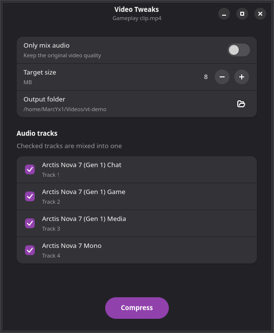

# Video Tweaks

Right-click a video in GNOME Files and pick **Video Tweaks** to:

- **Compress** it to a target size (default 8 MB), for example to fit Discord's upload limit.
- **Mix audio tracks** into one. Screen recorders such as GPU Screen Recorder or OBS can save game, chat, media and mic on separate tracks. Discord and most players only play the first track, so the rest is silent. Pick the tracks you want and they get mixed into one.
- **Only mix audio**: mix the tracks and keep the original video untouched (no re-encode).



Output goes next to the original video by default: `clip_8mb.mp4` when compressing, `clip_mixed.mp4` when only mixing.

## How it works

- `dcomp` does the compression: a two-pass x264 encode with the bitrate worked out from the target size and the clip length. It lowers the resolution for long clips so they don't turn to mush (480p under 600 kbit/s, 720p under 1500 kbit/s, else up to 1080p). It also works on its own: `dcomp <video> [MB] [output]`.
- `video-tweaks` is the window (GTK 4 + libadwaita). It mixes the chosen tracks with ffmpeg first, then runs `dcomp`.
- `nautilus/video_tweaks.py` adds the right-click item. It shows only when every selected file is a video.

## Install

### 1. Install the dependencies

You need ffmpeg (with libx264), the Python GTK 4 / libadwaita bindings (libadwaita 1.4 or newer) and nautilus-python. Package names can differ a little between releases.

**Fedora**
```
sudo dnf install ffmpeg python3-gobject libadwaita nautilus-python
```
Fedora's own `ffmpeg-free` has no libx264. Get `ffmpeg` from [RPM Fusion](https://rpmfusion.org/Configuration) (`sudo dnf swap ffmpeg-free ffmpeg --allowerasing`).

**Ubuntu / Debian** (Ubuntu 24.04 or newer)
```
sudo apt install ffmpeg python3-gi gir1.2-adw-1 python3-nautilus
```

**Arch**
```
sudo pacman -S ffmpeg python-gobject libadwaita python-nautilus
```

**Bazzite / Silverblue / other atomic Fedora**: Bazzite already ships all of these. On other atomic images, layer the missing ones with `rpm-ostree install`, then reboot.

### 2. Install Video Tweaks

```
git clone https://github.com/MarcYx1/video-tweaks.git
cd video-tweaks
./install.sh
nautilus -q
```

`install.sh` checks the dependencies, then copies `video-tweaks` and `dcomp` to `~/.local/bin` and the Files extension to `~/.local/share/nautilus-python/extensions`. `nautilus -q` restarts Files so it loads the extension. Open Files again and right-click a video.

To update: `git pull` then `./install.sh` again.
To remove: `./install.sh --uninstall`.

## Use without Files

```
video-tweaks clip.mp4 [more clips...]
```

## Test

```
python3 test_engine.py
```

Runs the mix, compress and cancel paths on a generated 4-track clip, no window needed.

## License

MIT, see [LICENSE](LICENSE).
